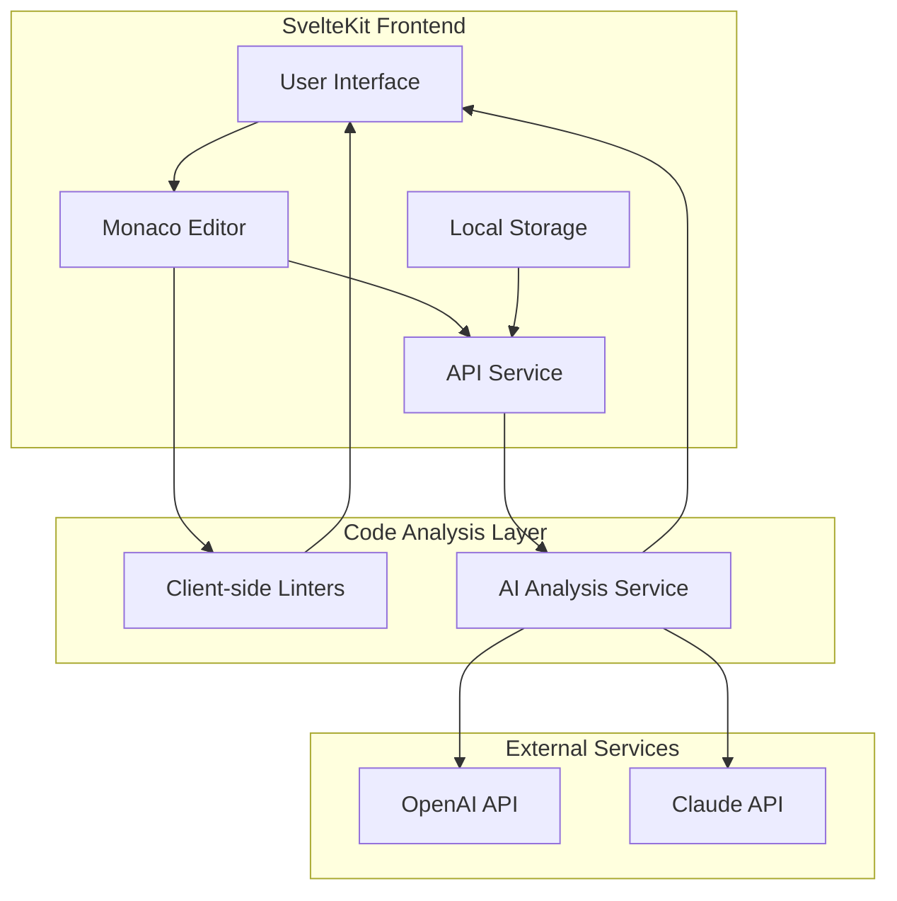
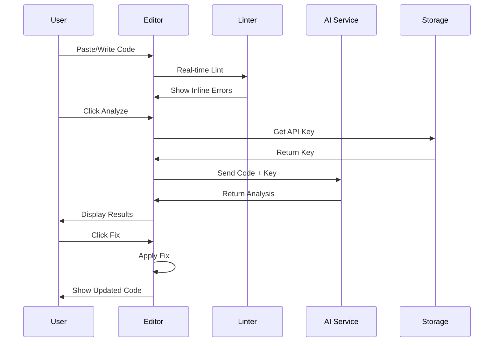

# Code Analyzer - SvelteKit Application Architecture

## Overview

A standalone SvelteKit application that provides AI-powered code analysis for error detection, best practices suggestions, and clean code recommendations. Users can submit code in JavaScript, TypeScript, Python, HTML, and CSS for analysis.

## Requirements Summary

| Requirement | Details |
|-------------|---------|
| **Framework** | SvelteKit |
| **Languages Supported** | JavaScript, TypeScript, Python, HTML, CSS |
| **Code Editor** | Monaco Editor |
| **AI Integration** | OpenAI/Claude API (user-provided keys) |
| **Key Storage** | Browser localStorage |
| **Deployment** | Vercel |
| **Location** | `code-analyzer/` directory in this repo |

---

## System Architecture



---

## Directory Structure

```
code-analyzer/
├── src/
│   ├── lib/
│   │   ├── components/
│   │   │   ├── editor/
│   │   │   │   ├── MonacoEditor.svelte
│   │   │   │   ├── EditorToolbar.svelte
│   │   │   │   └── LanguageSelector.svelte
│   │   │   ├── analysis/
│   │   │   │   ├── AnalysisPanel.svelte
│   │   │   │   ├── ErrorList.svelte
│   │   │   │   ├── SuggestionCard.svelte
│   │   │   │   └── CodeDiff.svelte
│   │   │   ├── settings/
│   │   │   │   ├── ApiKeyManager.svelte
│   │   │   │   └── PreferencesPanel.svelte
│   │   │   └── ui/
│   │   │       ├── Button.svelte
│   │   │       ├── Card.svelte
│   │   │       ├── Modal.svelte
│   │   │       ├── Toast.svelte
│   │   │       └── Tabs.svelte
│   │   ├── services/
│   │   │   ├── ai/
│   │   │   │   ├── openai.ts
│   │   │   │   ├── claude.ts
│   │   │   │   └── prompts.ts
│   │   │   ├── linters/
│   │   │   │   ├── javascript.ts
│   │   │   │   ├── typescript.ts
│   │   │   │   ├── python.ts
│   │   │   │   ├── html.ts
│   │   │   │   └── css.ts
│   │   │   └── storage.ts
│   │   ├── stores/
│   │   │   ├── editor.ts
│   │   │   ├── analysis.ts
│   │   │   └── settings.ts
│   │   ├── types/
│   │   │   ├── analysis.ts
│   │   │   ├── editor.ts
│   │   │   └── settings.ts
│   │   └── utils/
│   │       ├── codeParser.ts
│   │       └── formatters.ts
│   ├── routes/
│   │   ├── +layout.svelte
│   │   ├── +page.svelte
│   │   ├── settings/
│   │   │   └── +page.svelte
│   │   └── api/
│   │       └── analyze/
│   │           └── +server.ts
│   └── app.html
├── static/
│   └── favicon.png
├── tests/
│   ├── unit/
│   └── e2e/
├── package.json
├── svelte.config.js
├── vite.config.ts
├── tailwind.config.js
├── tsconfig.json
└── vercel.json
```

---

## Core Components

### 1. Monaco Editor Integration

The Monaco Editor will be the centerpiece of the application, providing:

- **Syntax highlighting** for JS, TS, Python, HTML, CSS
- **Real-time error markers** from linting results
- **Inline suggestions** from AI analysis
- **Quick fix actions** with one-click application

```svelte
<!-- MonacoEditor.svelte structure -->
<script lang="ts">
  import { onMount, onDestroy } from 'svelte';
  import type { editor } from 'monaco-editor';
  
  export let code: string = '';
  export let language: string = 'javascript';
  export let onCodeChange: (code: string) => void;
  export let markers: editor.IMarkerData[] = [];
</script>
```

### 2. Analysis Panel

Displays analysis results in an organized manner:

- **Errors Tab**: Critical issues that need fixing
- **Warnings Tab**: Potential problems and code smells
- **Best Practices Tab**: Suggestions for improvement
- **Clean Code Tab**: Refactoring recommendations

### 3. API Key Manager

Securely handles user API keys:

- Store keys in localStorage with encryption
- Support for both OpenAI and Claude APIs
- Key validation before storage
- Easy key management UI

---

## AI Integration

### Prompt Engineering

The AI prompts will be carefully designed to provide:

1. **Error Detection**: Identify syntax errors, runtime errors, and logical issues
2. **Best Practices**: Suggest industry-standard coding practices
3. **Clean Code**: Recommend refactoring for readability and maintainability
4. **Security**: Flag potential security vulnerabilities

### Sample Prompt Structure

```typescript
const analyzeCodePrompt = (code: string, language: string) => `
You are an expert code reviewer. Analyze the following ${language} code and provide:

1. ERRORS: List any syntax errors, bugs, or issues that would cause the code to fail
2. WARNINGS: Potential problems, code smells, or anti-patterns
3. BEST_PRACTICES: Suggestions to follow industry best practices
4. CLEAN_CODE: Recommendations for better readability and maintainability
5. FIXES: Provide corrected code snippets for each issue

Code to analyze:
\`\`\`${language}
${code}
\`\`\`

Respond in JSON format:
{
  "errors": [{ "line": number, "message": string, "fix": string }],
  "warnings": [{ "line": number, "message": string, "suggestion": string }],
  "bestPractices": [{ "category": string, "message": string, "example": string }],
  "cleanCode": [{ "issue": string, "recommendation": string, "refactored": string }]
}
`;
```

---

## Client-Side Linting

For instant feedback without API calls:

| Language | Linter/Parser |
|----------|---------------|
| JavaScript | ESLint (browser build) |
| TypeScript | TypeScript compiler API |
| Python | Pyodide + pylint |
| HTML | HTMLHint |
| CSS | Stylelint |

---

## State Management

Using Svelte stores for reactive state:

```typescript
// stores/editor.ts
import { writable } from 'svelte/store';

export const editorStore = writable({
  code: '',
  language: 'javascript',
  isAnalyzing: false,
  lastAnalysis: null
});

// stores/settings.ts
export const settingsStore = writable({
  openaiKey: '',
  claudeKey: '',
  preferredAI: 'openai',
  theme: 'dark',
  autoAnalyze: true
});
```

---

## User Flow



---

## Key Features

### 1. Real-time Error Highlighting
- Instant feedback as user types
- Red squiggly underlines for errors
- Yellow for warnings
- Blue for suggestions

### 2. One-Click Fixes
- Each issue shows a "Fix" button
- Clicking applies the suggested fix
- Undo/redo support

### 3. Code Comparison
- Side-by-side diff view
- Before/after comparison
- Highlight changed lines

### 4. Export Options
- Download fixed code
- Copy to clipboard
- Share analysis report

---

## Technology Stack

| Category | Technology |
|----------|------------|
| Framework | SvelteKit 2.x |
| Language | TypeScript |
| Styling | Tailwind CSS |
| Editor | Monaco Editor |
| AI | OpenAI GPT-4 / Claude 3 |
| Icons | Lucide Icons |
| Deployment | Vercel |
| Testing | Vitest + Playwright |

---

## Security Considerations

1. **API Keys**: Stored in localStorage, never sent to our servers
2. **Code Privacy**: All analysis happens client-side or direct to AI APIs
3. **No Logging**: User code is not logged or stored
4. **HTTPS Only**: Enforce secure connections

---

## Performance Optimization

1. **Lazy Loading**: Monaco Editor loaded on demand
2. **Debouncing**: Lint on pause, not every keystroke
3. **Caching**: Cache analysis results for identical code
4. **Web Workers**: Run linting in background threads

---

## Deployment Configuration

### vercel.json
```json
{
  "framework": "sveltekit",
  "buildCommand": "npm run build",
  "outputDirectory": ".svelte-kit/output"
}
```

---

## Future Enhancements

1. **GitHub Integration**: Analyze repositories directly
2. **VS Code Extension**: Bring analysis to the IDE
3. **Team Features**: Share analysis with team members
4. **Custom Rules**: Define project-specific rules
5. **More Languages**: Add support for Go, Rust, Java, etc.